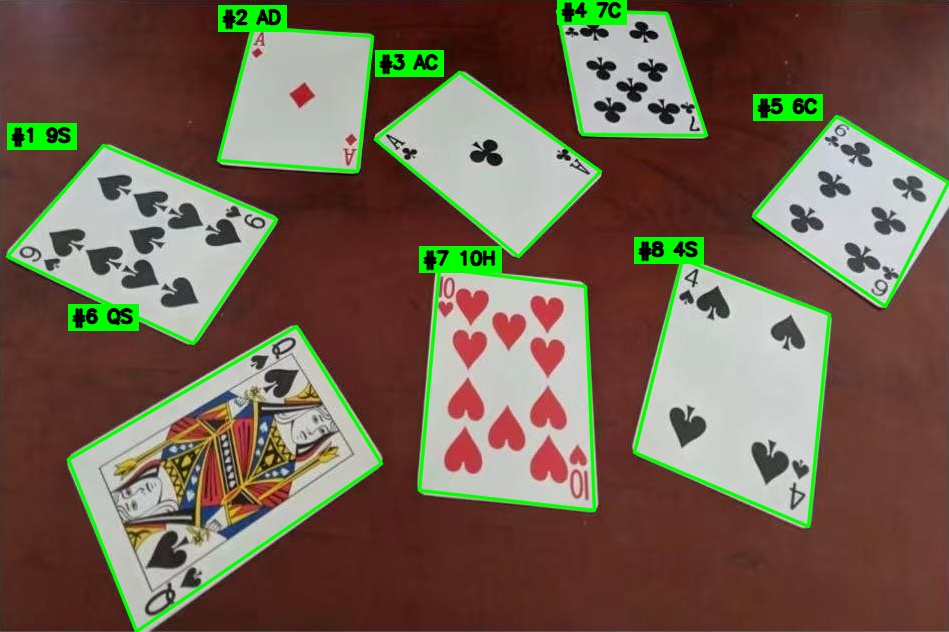

# Poker Detect · 扑克牌检测与识别

拍一张摊在桌面上的扑克牌照片，自动把每张牌定位出来、摆正，再读出点数和花色。

课程设计（实验十四）的工程部分。目前做的是**深色桌面**这一种场景，多环境适配放在后面的迭代里。



## 效果

示例图 `data/cards_sample.jpg`（8 张、随机角度、有透视）：

| 场景 | 定位 | 识别正确 |
| --- | --- | --- |
| 原图 | 8/8 | 8/8 |
| 暗光 45% | 8/8 | 8/8 |
| 过曝 1.35 | 8/8 | 7/8 |
| 高斯模糊 7×7 | 8/8 | 6/8 |
| JPEG q20 | 8/8 | 7/8 |
| 旋转 20° | 8/8 | 6/8 |
| 35% 透视 | 8/8 | 8/8 |

合计 50/56（89.3%），定位全部正确。数字由 `src/robustness_test.py` 直接跑出来。

## 目录

```
Poker Detect/
├─ data/                  测试照片
├─ docs/                  示例结果图
├─ output/                运行产物（不提交）
├─ src/
│  ├─ env_check.py        环境自检
│  ├─ image_basics.py     图像基础：尺寸、BGR、通道、灰度
│  ├─ card_detection.py   定位 + 透视校正
│  ├─ card_recognize.py   定位 + 点数 / 花色（主程序）
│  ├─ robustness_test.py  光照 / 模糊 / 压缩 / 旋转 / 透视 自测
│  └─ cardlib/
│     ├─ detector.py      定位算法
│     ├─ ranksuit.py      点数与花色识别
│     └─ imageio.py       中文路径安全的读写
├─ requirements.txt
```

## 环境

- Python 3.10+（实测 3.13）、opencv 4.12、numpy 2.2、pillow 11
- **字体依赖 Windows**：模板从 `C:\Windows\Fonts` 取（Times / Georgia / Arial / Cambria + Segoe UI Symbol 的花色符号）。macOS / Linux 需要改 `ranksuit._FONT_DIR` 并确认系统里有带 ♠♥♦♣ 的字体

```powershell
pip install -r requirements.txt
```

## 运行

下面的 `python` 换成你自己的解释器（本机是 `D:\Py\python.exe`）：

```powershell
python src/card_recognize.py            # 主程序，默认跑 data/cards_sample.jpg
python src/card_recognize.py 图片路径    # 换一张图
python src/card_detection.py            # 只看定位
python src/robustness_test.py           # 跑上面那张准确率表
```

结果写到 `output/step3_result.jpg`（原图 + 框 + 标签）和 `output/step3_cards.jpg`（摆正后的牌）。

## 团队协作

第一次拉代码：

```powershell
git clone https://github.com/WuSuu-Han/poker-detect.git
cd poker-detect
pip install -r requirements.txt
python src/card_recognize.py     # 先确认本机能跑通
```

每次改东西都开自己的分支，**不要直接推 `main`**：

```powershell
git pull                          # 先同步别人的改动
git checkout -b feature/light-table
# ...改代码...
python src/robustness_test.py     # 改完必须跑，准确率不能掉
git add -A
git commit -m "定位：加浅色桌面分割"
git push -u origin feature/light-table
```

推完在网页上发 Pull Request，等 Review 合进 `main`。

约定：

- 改定位或识别，必须贴出 `robustness_test.py` 前后两次数值，掉了要说明原因
- 一条分支只做一件事，提交信息写清“哪个模块 + 改了什么”
- `output/`、`scratch/` 不进仓库（`.gitignore` 已处理）

## 实现要点

**定位**

1. HSV 里按 `V > v_min`、`S < s_max` 取白牌，阈值用 Otsu / 分位数 / 固定值三组候选，挑检出最多的那组
2. 形态学开闭 + 连通域去噪 + 填洞
3. 轮廓用 `minAreaRect` 定朝向，再在凸包上沿四个对角方向取投影最远点当四角（不用 `approxPolyDP`，圆角会缩角）
4. 按旋转矩形的宽高比和填充率筛，白度校验必须相对背景（`max(70, 1.9 × 背景亮度)`），写死绝对值在暗光下会全灭
5. 透视变换成 210×294 的正面牌

**识别**

1. 四个方向各切一次左上角索引区（宽 0~20%、高 0~30%），取点数匹配最好的方向
2. 索引区里按连通域拆成上下两块：上面点数，下面花色
3. 点数：8 种系统字体渲染的 A~K 模板，做**倒角距离**（双向平均距离）匹配。归一化互相关会被笔画粗细带偏，牌面字比模板粗
4. “10”是唯一的双字符点数，按“两条竖笔画、一窄一宽、高度接近”直接判，比模板稳
5. 花色：先按颜色分红/黑；红色在红桃/方块里比形状，黑色在黑桃/梅花里比**腰部宽度**（35%~50% 高度处的宽度占比：黑桃三角顶不收腰，梅花三瓣收腰）

## 开发约定

- 定位那套（颜色分割 + 凸包取角 + 白度相对背景）已经调稳，七种退化场景定位全 8/8，**别整体重写**；要换思路（比如做浅色桌面）就单开分支
- `detector._split_blob`（粘连牌腐蚀分离）一次没跑过——示例图里没有重叠的牌，不要假设它可用
- 注释只写在“不看会写错”的地方，一行，中文；不写“为什么用这个算法”的作文，原理留给实验报告
- 两个尺寸别混：`detector.CARD_W/H`（210×294，定位输出）、`ranksuit.RECOG_W/H`（300×420，识别用），`read_card` 会自己缩放

## 已知限制

- **浅色桌面会失效**。整个定位靠颜色分割，白牌白桌直接糊成一片，要换边缘 + 霍夫或背景建模
- 花色黑色两选一的阈值 0.68 是在这副牌上量的，换字体差异大的牌可能失手
- 6/9 上下颠倒的混淆靠方向判定 + 模板，模糊到 7×7 会错
- 只验证了单层平铺的牌，重叠遮挡没验证
- 模板字体依赖 Windows 自带字体

## 路线图

- [x] 环境自检
- [x] 牌面定位 + 透视校正
- [x] 点数与花色识别
- [ ] 多环境：浅色桌面、木纹桌面、强反光
- [ ] 重叠 / 遮挡牌的分离
- [ ] 点数计数投票，专门救 6/9、3/8
- [ ] tkinter 界面
- [ ] 批量精度评测、实验报告 / 答辩 PPT
